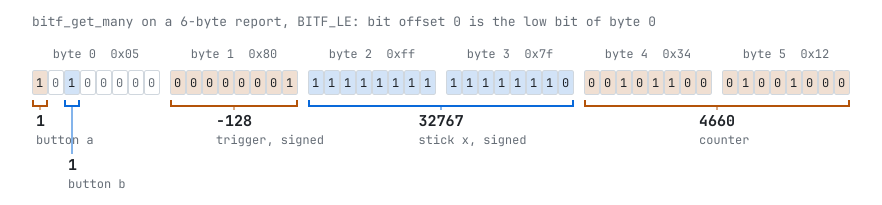

# bitspan

Read and write integer fields of 1 to 64 bits at any bit offset of a byte buffer.

- two layouts: `BITF_LE` (least significant bit first, little endian: USB/HID, most
  binary file formats) and `BITF_BE` (most significant bit first, big endian: network
  protocols, bitstreams)
- signed fields of any width with sign extension (`BITF_SIGNED`)
- checked calls that never read or write outside the buffer, plus inline unchecked
  readers and writers for hot loops after a single check
- batch read and write of a field list, validated once
- `bitf_copy`: copy a run of bits of any length between two buffers at any bit offsets; runs
  that overlap inside one buffer are copied as if through a temporary, when `dst` and `src`
  are the same pointer
- no allocation, no dependencies beyond the C99 standard headers

<picture>
  <source media="(prefers-color-scheme: dark)" srcset="docs/images/layout-dark.svg">
  
</picture>

## Build and install

```sh
cmake -S . -B build -DBUILD_SHARED_LIBS=ON
cmake --build build
cmake --install build --prefix /usr/local
```

Use it from CMake:

```cmake
find_package(bitspan REQUIRED)
target_link_libraries(app PRIVATE bitspan::bitspan)
```

Or with pkg-config:

```sh
cc app.c $(pkg-config --cflags --libs bitspan)
```

## Single-file form

`scripts/amalgamate.sh` writes `dist/bitspan/bitspan.h`. Copy it into your project and, in exactly
one `.c` file:

```c
#define BITF_IMPLEMENTATION
#include "bitspan/bitspan.h"
```

Define `BITF_STATIC` as well to keep every function private to that file.

## Usage

See [`examples/basic.c`](examples/basic.c). The header `include/bitspan/bitspan.h` is the
API reference.

Conventions:

- every function that can fail returns `BITF_OK` or an error code; `bitf_strerror` describes it:
  `BITF_ERR_ARG` (null pointer, width 0 or above 64, unknown flag), `BITF_ERR_BOUNDS` (field
  outside the buffer), `BITF_ERR_RANGE` (value does not fit the field width)
- on error nothing is written: `bitf_set_many` checks every field and value before writing
- the list calls take an optional `out_bad_index`: when the error comes from a field, it gets
  the index of the first field that failed
- `bit_offset` counts bits from the start of the buffer; with `BITF_BE` bit 0 is the most
  significant bit of the first byte, with `BITF_LE` it is the least significant one
- `bitf_get_many` returns signed fields sign-extended in the `uint64_t`; cast to `int64_t`
- names ending in `_` (`bitf_mask_`, `bitf_extend_`) are internal helpers of the inline
  readers and writers and may change in any release
- `bitf_get_unchecked`, `bitf_set_unchecked` and friends do no checking: call `bitf_check`
  or `bitf_fields_check` first; the writer keeps only the low `bit_len` bits of the value
- the library never allocates and keeps no state; calls on different buffers can run in parallel

## Versioning

Semantic Versioning, from 1.0.0 on. Within a major version:

- the API and ABI only grow: no function, macro, flag or struct member is removed or changes
  meaning, and the layout of `bitf_field_t` stays the same
- a function due to go away is marked deprecated in the CHANGELOG first and removed only in the
  next major version, together with a note on what to use instead
- names ending in `_` are not covered

Incompatible releases bump the major version and the soname. See [CHANGELOG.md](CHANGELOG.md).

## License

MIT, see [LICENSE](LICENSE).
